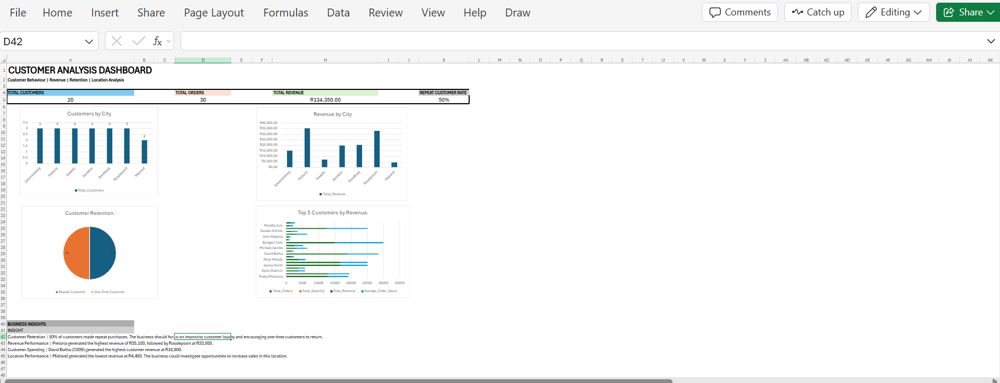
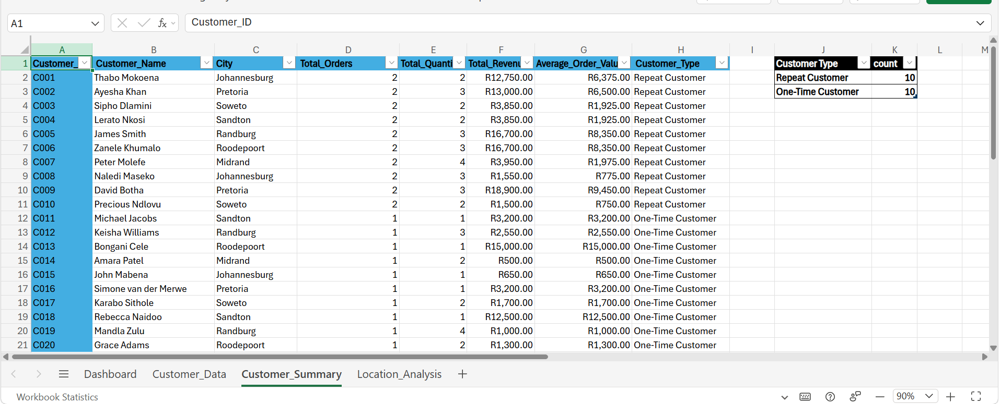

# Customer Analysis Dashboard | Excel

## Project Overview
This project analyses customer purchasing behaviour using Microsoft Excel. It focuses on customer revenue, repeat purchases, customer locations, and purchasing patterns.

## Objectives
- Analyse customer purchasing behaviour.
- Identify top customers by revenue.
- Measure repeat customer activity.
- Analyse revenue by city.
- Build a dashboard displaying key performance indicators (KPIs).

## Tools Used
- Microsoft Excel
- Excel formulas
- Pivot-style analysis and summary tables
- Charts and dashboard visualisation

## Excel Skills Demonstrated
- UNIQUE
- XLOOKUP
- COUNTIF
- SUMIF
- IF
- SORTBY
- Revenue calculations
- Customer segmentation
- Data visualisation
- KPI dashboard design

## Key Performance Indicators
| Metric | Result |
|---|---:|
| Total Customers | 20 |
| Total Orders | 30 |
| Total Items Sold | 45 |
| Total Revenue | R134,350 |
| Repeat Customers | 10 |
| One-Time Customers | 10 |
| Repeat Customer Rate | 50% |

## Key Insights
- 50% of customers made repeat purchases.
- Pretoria generated the highest city revenue at R35,100.
- David Botha was the highest-revenue customer at R18,900.
- Midrand generated the lowest city revenue at R4,450.
- Customer retention could be improved by encouraging one-time customers to return.

## Dashboard
The dashboard visualises:
- Total customers
- Total orders
- Total revenue
- Repeat customer rate
- Customers by city
- Revenue by city
- Customer retention
- Top 5 customers by revenue

## Project Files
- Customer_Analysis_Dashboard.xlsx
- Dashboard screenshots

## Data Disclaimer
The dataset used in this project is fictional and was created for educational and portfolio purposes.

## Dashboard Preview

## Customer Summary

## Author
Nkosana Mabunda
